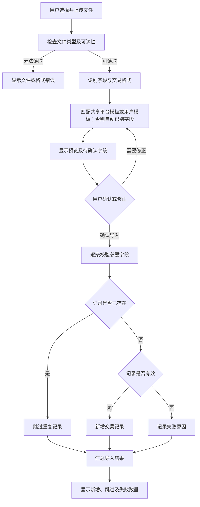
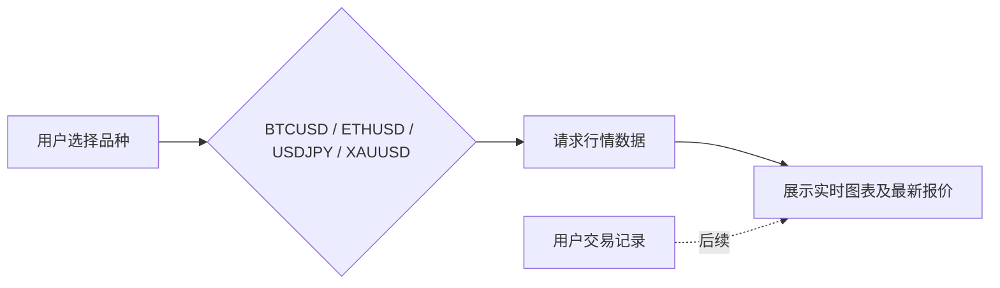
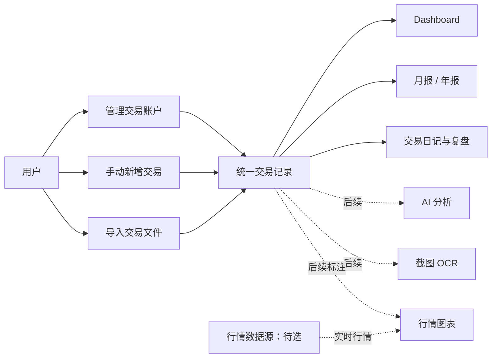
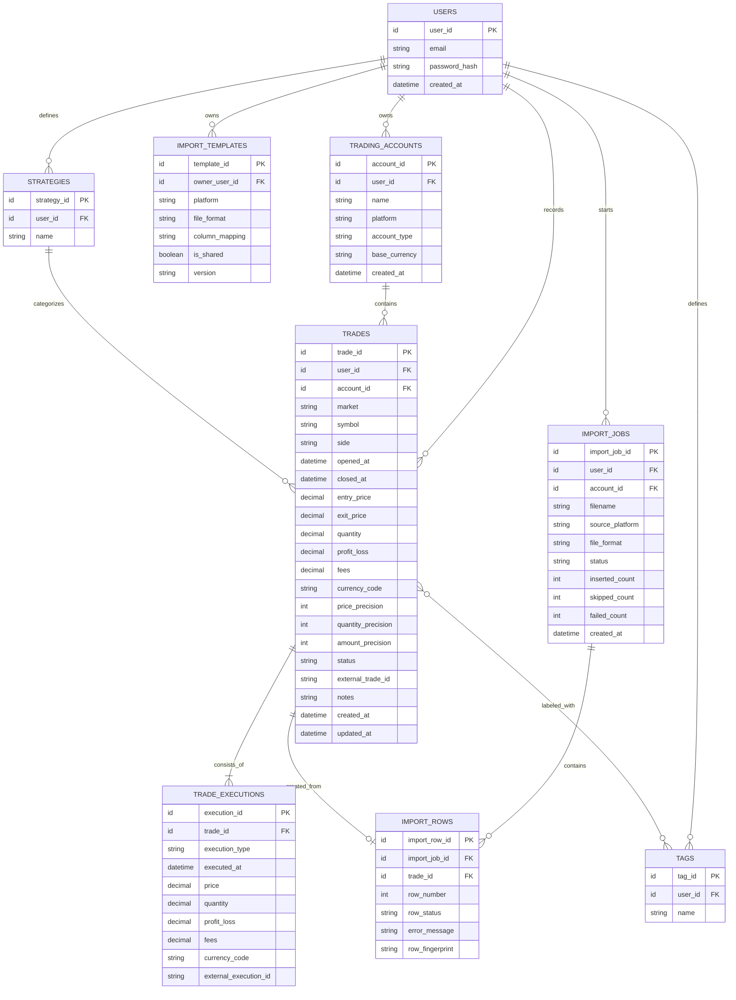

# PnL Trading Web — 产品计划（Draft）

> 当前阶段：产品草案。先梳理产品范围、主要流程和数据结构；具体技术选型、供应商和实施方案暂缓，等需求进一步确认后再定。

## 1. 产品目标

打造一个面向多市场交易者的 Web 平台，帮助用户记录交易、导入不同平台的交易数据，并通过报表和分析复盘交易表现。Web 优先，后续再考虑 App。

## 2. 已确认方向

- **市场范围：** 多市场，包括外汇、股票、加密货币等。
- **用户模式：** 多用户注册；每位用户的数据相互隔离。
- **盈亏录入：** 第一阶段由用户手动填写；后续考虑交易截图 OCR 自动提取。
- **显示货币：** 目前以 `$` 作为通用显示符号；交易金额保留原始币种和精度。不同币种汇总时的换算规则待定。
- **行情：** 第一版实时行情品种目标为 BTCUSD、ETHUSD、USDJPY、XAUUSD；行情供应商与费用待定。
- **导入：** 第一批重点支持 Elev8 和 Vantage，同时提供尽可能通用的文件识别和字段匹配流程。目标是覆盖常见文件格式，无法读取或识别的格式需给出清晰提示。
- **重复记录：** 上传 CSV 时，已存在的交易跳过；同一文件里的其他新记录照常导入。
- **盈亏冲突：** 手动录入盈亏作为报表主值；系统按价格/数量计算的结果仅作辅助参考。
- **部分平仓：** 按完整仓位统计交易次数和胜率，部分平仓成交归并到所属仓位。
- **报表日期与时区：** 以用户个人时区和平仓时间归属交易日期及月份。
- **行情成本：** 在满足实时行情目标的前提下，优先选择成本尽可能低的方案。
- **文件格式边界：** 第一版尽量支持可解析的表格/文本文件；图片和 PDF 放到后续 OCR 阶段。
- **平台同步：** MT5 自动同步为可选的后续功能。

## 3. 功能范围

### 3.1 用户与账户

- 注册、登录、登出和密码重设。
- 用户可管理个人资料和偏好设置。
- 用户可建立多个交易账户，并按账户查看或汇总交易表现。
- 所有交易、账户和导入记录均关联所属用户，确保用户之间的数据隔离。

### 3.2 交易记录与日记

- 创建、查看、编辑、删除交易记录（CRUD）。
- 支持多市场、品种、买卖方向、开仓和平仓时间及价格、数量、盈亏、手续费、策略、标签和备注等字段。
- 用户可手动填写盈亏；若开仓/平仓价格和数量齐全，也保留辅助核算盈亏的能力。两者不一致时，手动盈亏作为报表主值，系统计算值作辅助参考。
- 一笔完整仓位可包含多条进场或部分平仓成交；报表按完整仓位汇总统计。
- 保留原始币种和足够的数值精度；界面目前以 `$` 作为通用货币符号，不能因此丢失交易记录中的币种信息。
- 后续考虑上传交易截图并通过 OCR 提取候选字段，由用户核对后保存。

### 3.3 文件导入

- 用户可尝试上传常见表格和文本格式（CSV、XLS/XLSX 等）；目标是尽量覆盖其他可解析格式。
- 图片、PDF 等非结构化文件可作为后续 OCR / 文档解析扩展，不视作第一版必定支持的结构化导入格式。
- 自动尝试识别字段和交易数据格式，并映射到平台的统一交易结构。
- 导入前展示预览；未识别或不确定的字段由用户确认或修正。
- 对重复记录执行跳过，不覆盖或重复新增。
- 新记录继续导入；导入完成后显示新增、跳过、失败数量及失败原因。
- 优先适配 Elev8 和 Vantage；其他平台通过通用识别、字段映射和用户确认尽可能支持。
- 采用“共享平台模板 + 用户自定义模板”的混合方案：经验证的平台格式（如 Elev8、Vantage）可维护为共享模板；用户自行修正的映射先仅供该用户使用，避免把用户文件或私有格式未经确认分享给其他用户。

> “通用导入”是产品目标。若文件缺少必要数据或结构无法识别，系统应报告问题并允许用户修正，不能静默导入错误交易。

### 3.4 Dashboard 与报表

- Dashboard：总盈亏、净盈亏、胜率、交易次数、平均盈亏、最大回撤及近期表现。指标按“报表口径（第一版已确认）”计算。
- 月报与年报为首要报表；周报可选或后续增加。
- 按日期、账户、市场、品种、策略和标签筛选。
- 汇总视图支持跨市场查看，也支持按市场或账户拆分。
- 毛盈亏、手续费等成本和净盈亏尽量分开展示；计算口径需进一步确认。

### 3.5 实时行情与图表

- 第一版目标品种：BTCUSD、ETHUSD、USDJPY、XAUUSD。
- 提供这些品种的实时行情图表；实际可用性取决于数据源、市场覆盖、延迟、授权及费用。
- 后续可在图表上标记开仓和平仓位置，用于交易复盘。
- 优先选择满足实时目标且成本尽可能低的方案；供应商覆盖、实际延迟、授权及费用待评估。

### 3.6 AI 分析（后续阶段）

- 总结指定时间范围内的交易表现。
- 比较不同市场、品种和策略的表现。
- 提示可能的交易习惯或风险模式，并尽量关联到可核对的交易记录。
- 具体分析指标、模型和服务方式待定。

### 3.7 后续集成

- MT5 自动同步（可选）。
- 交易截图 OCR 自动提取（可选）。
- 扩展更多平台的导入格式和自动同步能力。

## 4. 主要流程图

### 4.1 文件导入与重复跳过

### 4.2 行情查看

### 4.3 交易记录与报表

## 5. 数据库草图（概念模型）

以下为初步实体关系，不是最终 schema；字段和关系可随产品范围调整。

### 重复记录识别草案

1. 若来源文件提供稳定的外部交易 ID，优先使用 **用户 + 账户 + 平台 + 外部交易 ID** 判断重复。
2. 若没有外部 ID，再用标准化后的关键字段生成指纹，例如 **用户 + 账户 + 市场 + 品种 + 方向 + 开仓/平仓时间 + 价格 + 数量**。
3. 指纹字段、时间精度、部分平仓和同一时刻同价交易的处理规则需要用 Elev8 / Vantage 的真实样例验证后确定。
4. 导入时只跳过匹配的记录，保留其他新记录；不自动覆盖已有交易。

### 报表口径（第一版已确认）

- **报表日期：** 以用户个人时区下的完整仓位平仓时间归属交易日期和月份；持仓中的仓位单独展示，不计入已实现盈亏报表。
- **时区：** 每位用户设置一个报表时区；报表按该时区划分日期和月份。账户级时区可后续扩展。
- **已实现盈亏：** 手动录入盈亏为报表主值；系统按价格和数量计算的盈亏为辅助参考。手动值缺失且计算数据齐全时才使用计算值，并标记数值来源。
- **净盈亏：** 净盈亏 = 毛盈亏 − 手续费及其他已记录成本。若来源平台的 PnL 已含费用，导入时标明口径，避免重复扣除。
- **胜率：** 以完整仓位为单位：盈利平仓仓位数 ÷（盈利平仓仓位数 + 亏损平仓仓位数）；盈亏为零的仓位不计入胜负分母，另行显示数量。
- **交易次数：** 按完整仓位计数；多次进场或部分平仓成交归并为一笔。导入时优先使用平台提供的仓位/订单标识。
- **跨币种汇总：** 始终保留原始金额和币种。第一版分别按币种展示；待确定汇率来源和换算时点后，再提供统一美元换算。
- **最大回撤：** 按平仓时间排序的累计净盈亏曲线计算，并注明这是交易记录口径，不等同于账户净值回撤。

## 6. 分阶段草案

### 第一阶段：Web 基础版本

- 多用户注册、登录和数据隔离。
- 交易账户管理及多市场交易 CRUD。
- 手动填写盈亏，并记录开仓/平仓价格和数量；以 `$` 作为通用显示符号，同时保留原始币种及精度。
- 文件上传、格式识别、字段确认、重复跳过和结果汇总；优先适配 Elev8 与 Vantage，支持范围按可解析格式逐步扩展。
- 实时行情首批品种：BTCUSD、ETHUSD、USDJPY、XAUUSD；供应商在满足实时目标前提下优先考虑低成本方案。
- 优先适配 Elev8 与 Vantage，同时搭建通用导入流程。
- Dashboard、月报和年报。

### 第二阶段：复盘能力

- 策略、标签和交易日记完善。
- 更多指标、筛选及周报。
- 图表标记交易进出场。

### 第三阶段：数据与智能扩展

- 按确定的市场范围接入实时行情。
- AI 分析。
- 图片 OCR 交易录入。
- MT5 或其他平台自动同步。

## 7. 技术方向（初步确认，细节待定）

### 已选方向

- **后端语言与框架：** PHP + Laravel。
- **数据库 / 后端服务：** Supabase，优先考虑使用其 PostgreSQL 数据库；具体是否使用 Supabase Auth、Storage 等功能仍待设计。
- **部署平台：** Render。
- **运行状态监控：** 候选为 UptimeRobot，用来定时检查网站 HTTP 状态并在不可用时告警；是否就是你记得的那个 Bot/服务，之后可再确认。

### 暂缓确认的技术细节

目前先不锁定前端框架、Supabase 功能边界、行情供应商或其他第三方服务。进入技术设计时再评估：

- Web 前端方案，以及 Laravel 与 Supabase 的职责划分（例如由 Laravel 负责登录和业务权限，Supabase 提供 PostgreSQL）。
- 数据库 schema、用户数据隔离策略和备份方式。
- 文件上传、解析和重复检测实现方式。
- 实时行情供应商、市场覆盖、许可和费用。
- OCR / AI 服务及用户数据处理方式。
- Render 部署、健康检查、备份、监控和安全方案。

### 语言建议

Web 第一版采用 **PHP + Laravel** 作为主要后端语言和框架；页面交互可先用 Laravel 配套的轻量前端方案，需要更丰富交互时再加入 **TypeScript**。

理由：产品第一阶段的重点是多用户账户、交易 CRUD、文件导入、重复检测、权限隔离和报表，Laravel 适合快速搭建这类 Web 业务功能。实时行情先通过供应商 API / WebSocket 集成；将来 AI、OCR 或数据处理有明确需要时，再评估是否增加 Python 服务。

### 监控与 Render 休眠说明

UptimeRobot 这类外部监控服务适合检查站点是否可访问并发送告警。Render 免费 Web Service 在连续 15 分钟没有收到入站流量后会休眠，之后收到请求时会重新启动，可能需要约一分钟；因此监控告警与生产可用性方案应分开考虑，不能把定时探测当作正式的常驻运行保障。正式上线前再按预算选择 Render 实例计划。

## 8. 仍待确认的问题

- 不同平台缺少仓位/订单标识时，如何把部分平仓成交准确归并成完整仓位？
- 多币种合并成美元时使用什么汇率来源和换算时点？

---

本文件为持续编辑中的草案；需求确认后再更新数据库细节和技术方案。
